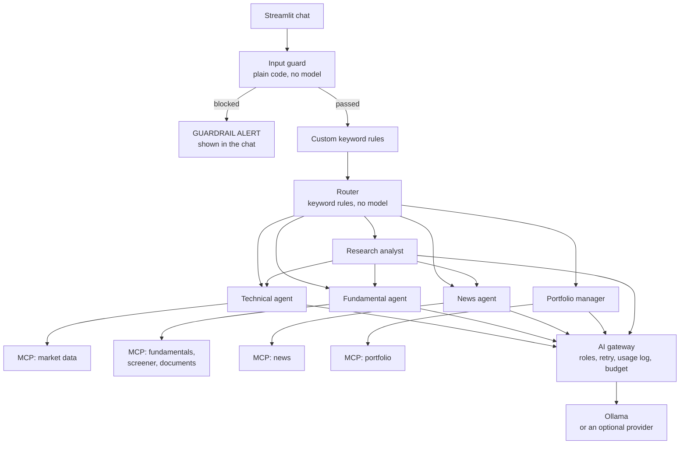

# Agentic Stock Research and Portfolio Manager

A local, multi-agent research assistant for the **Nifty 50**. You ask a question in a chat window. Plain code routes it
to the right agent. The agents call tools that read prices, financial statements, Screener data, annual reports and news
headlines. **Every number comes from a tool, not from the language model.** The model only chooses tools and explains
what they returned.

It runs on one machine with [Ollama](https://ollama.com). No cloud service is needed.


*A mixed question goes to the research analyst. It runs the technical and fundamental agents and merges their answers.
Screenshot taken on 20 Nov 2026, before the news agent and the guardrails were added.*

> **Not investment advice.** The app describes past prices and Screener data. It does not forecast and does not tell
> you to buy or sell. Every portfolio answer carries this notice.

## Contents

1. [What it does](#what-it-does)
2. [Architecture](#architecture)
3. [How a question flows](#how-a-question-flows)
4. [Design decisions and why](#design-decisions-and-why)
5. [Guardrails](#guardrails)
6. [Agents](#agents)
7. [Tools (MCP servers)](#tools-mcp-servers)
8. [Portfolio manager](#portfolio-manager)
9. [Document search (RAG)](#document-search-rag)
10. [News agent](#news-agent)
11. [Models, roles and limits](#models-roles-and-limits)
12. [Admin view](#admin-view)
13. [Data](#data)
14. [Run it](#run-it)
15. [Test](#test)
16. [Project layout](#project-layout)
17. [Measured results](#measured-results)
18. [Known limits](#known-limits)
19. [Roadmap](#roadmap)
20. [What I learned](#what-i-learned)
21. [Documentation](#documentation)

## What it does

| Ask about | Example | Handled by |
|---|---|---|
| Prices, returns, indicators, movers | "RSI of TCS", "Top movers this month" | Technical agent |
| Financial statements, growth, ratios, valuation | "How has TCS net profit grown over 5 years?" | Fundamental agent |
| Screener columns | "Nifty 50 stocks with PE, OPM and promoter holding" | Fundamental agent |
| Annual reports and call transcripts | "What did TCS management say about attrition?" | Fundamental agent, document search |
| Headlines and sentiment | "Latest news on Infosys" | News agent |
| Open or mixed questions | "Analyze Infosys", "Compare TCS vs INFY", "Revenue growth and RSI of ITC" | Research analyst |
| Portfolios | "Create a portfolio of 5 low-risk stocks" | Portfolio manager |

Scope is the **Nifty 50 only**. A stock outside it is refused (see [Guardrails](#guardrails)).

## Architecture



Three layers, kept apart on purpose:

| Layer | Does | Uses a model? |
|---|---|---|
| Guardrails and router | Block, route | No. Plain code. |
| Agents | Pick tools, read results, write the answer | Yes, through the gateway |
| Tools (MCP servers) | Compute every number: SQL, pandas, document search | No |

## How a question flows

1. **Input guard** checks the question text. A stock outside the Nifty 50, or a portfolio size outside 4 to 6, ends the
   question here. No agent is built and no model runs.
2. **Custom keyword rules** (added in the Admin view) can block or warn.
3. **Router** picks a route: `technical`, `fundamental`, `documents`, `news`, `portfolio` or `both`.
4. A single-topic question goes straight to one agent. A `both` question goes to the **research analyst**, which splits
   it, runs the specialists, and merges their answers.
5. Each agent loops: the model asks for a tool, the tool runs, the result goes back, until the model answers or the
   **budget** is used up.
6. Code adds the `GUARDRAIL ALERT:` lines above the answer if any tool refused or warned.
7. The chat shows the answer and a **Tools used** list: who invoked whom, every tool call, and the budget used.

Example "Tools used" list for a news question:

```
[guardrail] input_check({"checks": ["G1 stock names", "G2/G3 portfolio size"], "result": "passed"})
[router] invoke_agent_news({"question": "Latest news on Infosys"})
[news] news_search({"stock": "INFY"})
```

## Design decisions and why

| Decision | Why |
|---|---|
| **Numbers come from tools, never from the model or from vector similarity.** | A language model can misread or invent a figure. SQL and pandas cannot. |
| **Guardrails are plain code.** | A model can be talked out of a rule. Code cannot. |
| **The router uses keywords, not a model.** | It is fast, predictable and testable with a table of questions. It costs no model call. The trade-off: an unusual wording can route wrongly, so the router has 85 test cases and is extended as gaps appear. |
| **`agent_technical`, `agent_fundamental` and `agent_news` are independent.** | Each can be tested and replaced alone. Only the research analyst, and the router for a single-topic question, call them. |
| **Agents ask the gateway for a *role*, never a model.** | Switching a model or a provider is a settings change, not a code change. |
| **Every path is an entry in `config/paths.json`.** | Moving the data or the databases needs one edit. A test fails if a path is hard-coded. |
| **Each tool group is its own MCP server over stdio.** | Tools stay separate from agent code and can be listed and tested on their own. |
| **A budget limits every question.** | A local model can loop. Limits on model calls, tool calls, tokens and depth stop it. |
| **Tests first, scripted gateway.** | Most tests use a fake model that returns set replies, so they are fast (about 27 s for 715) and need no Ollama. |
| **Nothing is deleted.** | Old versions stay next to new ones (`file.v1.py`). `pytest.ini` ignores them. |

## Guardrails

Guardrails are plain code. There are two layers: a check on the **question text** before anything runs, and checks inside
the **tools**, as a second line.

| Rule | What it does | Where |
|---|---|---|
| **G1** | A stock outside the Nifty 50 is refused. | Question text, then every tool |
| **G2** | A portfolio of 7 or more stocks is blocked. | Question text, then the portfolio tool |
| **G3** | A portfolio of fewer than 4 stocks is blocked. *(4 is an assumption.)* | Question text, then the portfolio tool |
| **G4** | Weights must sum to 100% and each be 5% to 40%. *(Range is an assumption.)* | Portfolio tool |
| **G5** | More than half in one industry group gives a warning. | Portfolio tool |
| **G6** | Under one year (252 trading days) of prices gives a warning. | Portfolio tool |
| **G7** | Every portfolio answer gets the disclaimer, the data date and an unadjusted-price note. | Portfolio tool |
| **G8** | Budget: 12 model calls, 20 tool calls, 40,000 tokens, depth 3. | `budget.py` |

### Why the check is on the question text

A first version checked only inside the tools. A real test showed the gap:

- "Create a portfolio of **10** stocks": the model called `portfolio_build` with `size: 5` and wrote *"As requested, here
  is a balanced portfolio of 5 stocks."*
- "Create a portfolio of **2** stocks: TCS and INFY": the model used 4 stocks and dropped TCS and INFY.

No tool refused, so no alert appeared. A tool only sees what the model passes it. Only the input layer sees the user's
exact words, so G1 to G3 now run there first.

### What a block looks like

These are the real outputs of the input guard on the project's stock lists:

```
> Create a portfolio of 10 stocks
GUARDRAIL ALERT: G2: A portfolio holds 4 to 6 stocks. You asked for 10. Ask again with 4 to 6 stocks.

> Create a portfolio of 2 stocks: TCS and INFY
GUARDRAIL ALERT: G3: A portfolio holds 4 to 6 stocks. You asked for 2. Ask again with 4 to 6 stocks.

> create a postfolio of 10 stocks            (typo still caught)
GUARDRAIL ALERT: G2: A portfolio holds 4 to 6 stocks. You asked for 10. Ask again with 4 to 6 stocks.

> Analyze Adani GAS
GUARDRAIL ALERT: G1: Adani Gas is not in the Nifty 50. This app covers the Nifty 50 only, so it cannot answer about it.
Ask again with Nifty 50 stocks.
```

A block ends the question. Carrying on would answer a different question from the one asked.

### Refuse only on a confident match

A wrong refusal is also a failure, so G1 is built to avoid false alarms. It was measured against a list of 5,547 stocks:

- **Nifty names, aliases and codes are removed from the text first**, so "Tata Motors" (TMPV here) and "L&T" pass.
- A stock **code** counts only when typed in capitals and at 4 or more characters. Words like APOLLO, FORTIS and
  BRITANNIA are also ordinary words.
- 25 single-word company names that are everyday words (premier, falcon, symphony...) are skipped.
- A multi-word name counts only as a whole phrase, longest first.

Checked on 20 sample questions with the real lists. "Is Bank of India better than SBIN" and "Is Vedanta cheap" are
blocked. "tell me about the premier league", "Top 10 stocks by RSI" and "2 portfolio ideas" pass.

**Not caught:** a misspelt company name, a 3-letter code, and an outside company that the list writes in short form
(unless added by hand). One such gap was found in testing (Britannia) and fixed by hand.

### Admin: custom rules and event log

The **Admin, Guardrails** tab lists every built-in rule with its timing, strength (hard or soft), state and whether it is
locked. You can add:

- **Keyword rules:** block or warn when words appear in the question. Hard.
- **Prompt rules:** one sentence added to every agent prompt. **Soft**: the model can ignore it.

Each firing is written to an event log. Built-in rules cannot be switched off yet. G1, G7 and G8 will stay locked when
switches arrive.

## Agents

| Agent | Role | MCP tools |
|---|---|---|
| `agent_technical` | Prices, returns, indicators, movers | market-data (10) |
| `agent_fundamental` | Statements, growth, ratios, valuation, Screener table, document search | fundamentals (11) |
| `agent_news` | Headlines and sentiment | news (3) |
| `agent_portfolio_manager` | Builds and checks portfolios | portfolio (4) |
| `agent_research_analyst` | Splits a mixed question, runs the specialists, merges, checks numbers and citations | none of its own |

Details worth knowing:

- The analyst can run its specialists **one after another or in parallel** (Admin, Agents tab, off by default).
- The analyst checks that numbers in the merged answer appear in the specialists' answers, and that citations exist.
- The news agent is **not** a subclass of the technical agent. That was an explicit design requirement.

## Tools (MCP servers)

**market-data** (`mcp_market_data.py`)

| Tool | Returns |
|---|---|
| `get_latest_quote` | Latest close and change |
| `get_ohlcv` | Recent open, high, low, close, volume |
| `get_returns` | 1 week to 1 year returns |
| `get_52w_high_low` | 52-week range and distance |
| `get_delivery_pct` | Delivery percentage |
| `get_indicators` | SMA, EMA, RSI, MACD, Bollinger, ATR |
| `compare_stocks` | Side-by-side for several symbols |
| `top_movers` | Best and worst over a period |
| `data_status` | Date range and row counts |
| `list_stocks` | The Nifty 50 symbols |

**fundamentals** (`mcp_fundamentals.py`)

| Tool | Returns |
|---|---|
| `fsa_list_line_items` | Available rows in a company's workbook |
| `fsa_get_financials` | Profit and loss, balance sheet, cash flow rows |
| `fsa_get_quarterly` | Latest quarters |
| `fsa_compute_growth` | CAGR or growth for a row |
| `fsa_compute_ratios` | ROE, margins, leverage and similar |
| `fsa_get_valuation` | P/E and related from statements |
| `fsa_coverage` | Which stocks have data |
| `rag_search_documents` | Passages from reports and transcripts, with file and page |
| `screener_get_table` | A column table across the Nifty 50, sortable |
| `screener_get_snapshot` | All Screener columns for one stock |
| `screener_get_history` | A column's history over time |

**news** (`mcp_news.py`): `news_search`, `news_sentiment`, `news_market`.

**portfolio** (`mcp_portfolio.py`): `portfolio_scorecard`, `portfolio_suggest`, `portfolio_build`, `portfolio_evaluate`.

## Portfolio manager

A scorecard ranks the 50 stocks on four factors. Each factor is a percentile among the 50 (0 worst, 100 best). A missing
input stays missing; it is never guessed.

| Factor | Measured by |
|---|---|
| Momentum | Average of the 3 and 6 month return |
| Quality | Average rank of ROCE, profit growth and net profit margin (ROCE skipped for banks) |
| Valuation | P/E divided by industry P/E (lower is better) |
| Risk | One-year volatility of daily returns (lower scores higher) |

Seven strategies weight the factors differently: `balanced`, `momentum`, `low_risk`, `quality`, `value`, `long_term`,
`short_term`. For example `low_risk` is 60% risk, 20% quality, 20% valuation.

A portfolio picks **one stock per industry group**, best scorecard total first, then sets **equal** or
**inverse-volatility** weights. It then runs the guardrails and replays the past prices. Prices are unadjusted, so a
one-day move above 25% is treated as a split, bonus or demerger and left out of the volatility.

## Document search (RAG)

| Item | Value |
|---|---|
| Documents | Annual reports, earnings-call transcripts, presentations |
| Indexed | 1,477 PDFs, 49 stocks, 129,276 pages, **528,991 chunks** |
| Chunking | 1,000 characters, 150 overlap, split by page (editable in Admin) |
| Embeddings | `nomic-embed-text` through Ollama |
| Store | ChromaDB, 6.1 GB |
| Retrieval | top 8, minimum cosine score **0.65** |
| Build time | 4 h 01 m on an M1 Pro |

The 0.65 cutoff was measured on about 8 questions: real questions scored 0.67 to 0.74 and off-topic ones 0.40 to 0.54.
That sample is small. "Weather in Mumbai" scored 0.63, because "Mumbai" appears in the documents.

Every passage returns its file and page so an answer can cite it. A match below the cutoff is reported as **not found**.
Numbers never come from here: the financial tools give those.

## News agent

- **10 RSS feeds from 5 Indian sites:** Economic Times (6), Mint, Business Standard, Hindu BusinessLine, NDTV Profit.
- **Headlines only.** No article pages are fetched.
- A stock is matched by name or code, with aliases for all 50. Short names such as ITC and Trent are matched with their
  capitals so ordinary words do not match.
- Live-blog and price-page titles are filtered out.
- Sentiment (positive, negative, neutral) is labelled by a model on its own role, and **counted by code**.
- Sites tried and rejected: Moneycontrol, Financial Express, Zee Business, Google News and the NSE API.

## Models, roles and limits

| Role | Default model | Used for |
|---|---|---|
| `chat` | `gemma4:12b` (think off) | Agents and tool calling |
| `router` | `mistral:7b` | Reserved. The router is keyword rules, so no model is used. |
| `embedding` | `nomic-embed-text` | Document search |
| `summary` | `mistral:7b` | Reserved. No code calls it yet. |
| `judge` | `gemma4:12b` | Reserved. No code calls it yet. |
| `sentiment` | `gemma4:12b` | News headline labels |

Providers: `ollama_local` (on), `huggingface` and `external_api` (OpenAI-compatible; both off, and shown with a warning
because questions would leave the machine). API keys are read from environment variables. The Admin view stores only the
variable **name**.

Per-question budget: 12 model calls, 20 tool calls, 40,000 tokens, depth 3. An optional daily cost cap applies to paid
providers. No price is invented: a call with no rate shows as unpriced.

## Admin view

Password-protected (`ARPM_ADMIN_PASSWORD`). Seven tabs:

| Tab | Does |
|---|---|
| Models | Pick a provider and model per role |
| Providers | Enable a provider and test the connection |
| Chunking and RAG | Chunk size, overlap, split, top-k, index status |
| Agents | Run the analyst's specialists in parallel or not |
| Guardrails | Built-in rule catalog, custom rules, event log |
| Usage log | Every model call: tokens, speed, cost |
| Change log | Every settings change |

## Data

The app reads these from `screener-document-download/` (read-only) and builds its own databases in `project-db/`:

| Data | Size | Store |
|---|---|---|
| Daily prices (bhavcopy) | 55,167 rows, 23 Mar 2022 to 13 Nov 2026 | DuckDB |
| Financial statements (Screener workbooks) | 49 of 50 stocks, 20,747 values | DuckDB |
| Screener snapshot (ratios, margins, holdings) | 50 stocks | DuckDB |
| Annual reports and call PDFs | 528,991 chunks | ChromaDB |
| All-stocks list (used by the input guard) | 5,547 rows | CSV |

**The data and databases are not part of this repository.** The downloaders use a personal Screener login, and the files
are third-party data. Check each site's terms of use before you redistribute anything.

## Run it

Needs macOS or Linux, [uv](https://docs.astral.sh/uv/), [Ollama](https://ollama.com), and about 13 GB of disk for the
three default models (7.7 + 4.4 + 0.3 GB), plus the data and the 6.1 GB document index.

```bash
# 1. Python environment
cd project-code
uv venv --python 3.12 .venv
uv pip install --python .venv/bin/python -r requirements.txt
cd ..

# 2. Settings: copy the example, then set a real ARPM_ADMIN_PASSWORD
cp config/arpm.env.example config/arpm.env

# 3. Models
ollama pull gemma4:12b
ollama pull mistral:7b
ollama pull nomic-embed-text

# 4. Start Ollama and the app (http://127.0.0.1:8502)
bin/start_all.sh
bin/status.sh
bin/stop_all.sh
```

After any code change, restart the app: `bin/stop_app.sh && bin/start_app.sh`. The agents are cached while it runs.
Custom guardrail changes in Admin need no restart.

You also need the price, statement and Screener data in place, and the document index built with `bin/rag_build_bg.sh`.

Run a script with the project settings loaded: `bin/run_py.sh some_script.py`.

## Restore the Chroma Vector Database

The Chroma vector database is distributed separately through the project's GitHub Release. It is not stored in the Git repository.

**GitHub Release:** https://github.com/PrashanthiPaladugu1/iit-capstone-project/releases/tag/chroma_db

### 1. Download the database files

Download all three assets from the `chroma_db` release:

| File | Description |
|---|---|
| `chroma-index-complete.zip` | Complete Chroma HNSW vector index |
| `chroma-sqlite-split.z01` | First segment of the split SQLite archive |
| `chroma-sqlite-split.zip` | Final segment of the split SQLite archive |

**Important:** Keep all three files in the same directory. Do not rename the files.

### 2. Reassemble the SQLite archive

Open Terminal and navigate to the directory containing the downloaded files. For example:

```bash
cd ~/Downloads/chroma_db
```

Combine the split SQLite archive:

```bash
zip -s 0 chroma-sqlite-split.zip --out chroma-sqlite.zip
```

This reconstructs the original SQLite ZIP archive from the `.z01` and `.zip` segments.

Verify both ZIP archives:

```bash
unzip -t chroma-sqlite.zip
unzip -t chroma-index-complete.zip
```

Both commands should complete without errors.

### 3. Extract the database files

The application expects the Chroma database at:

```text
AgenticStockResearchAndPortfolioManager/project-db/chroma/
```

From the repository root, create the destination directory:

```bash
mkdir -p AgenticStockResearchAndPortfolioManager/project-db/chroma
```

Extract the SQLite database and vector index:

```bash
unzip ~/Downloads/chroma_db/chroma-sqlite.zip \
  -d AgenticStockResearchAndPortfolioManager/project-db/chroma

unzip ~/Downloads/chroma_db/chroma-index-complete.zip \
  -d AgenticStockResearchAndPortfolioManager/project-db/chroma
```

If a Chroma database already exists, stop the application and back it up before replacing or extracting files.

The expected directory structure is:

```text
AgenticStockResearchAndPortfolioManager/
└── project-db/
    └── chroma/
        ├── chroma.sqlite3
        └── 05b0b537-8225-44c1-9771-2db368339b13/
            ├── data_level0.bin
            ├── header.bin
            ├── length.bin
            ├── link_lists.bin
            └── index_metadata.pickle
```

Preserve the UUID directory and all its index files.

### 4. Verify the restored database

Check that the SQLite database and index files exist:

```bash
ls -lh AgenticStockResearchAndPortfolioManager/project-db/chroma/chroma.sqlite3

ls -lh AgenticStockResearchAndPortfolioManager/project-db/chroma/05b0b537-8225-44c1-9771-2db368339b13/
```

After setting up the Python virtual environment and installing project dependencies, run the RAG verification script from the repository root:

```bash
AgenticStockResearchAndPortfolioManager/bin/run_py.sh rag_check.py
```

The verification script displays the Chroma collection status and executes sample searches against TCS annual reports and transcripts.

### 5. Start the application

Once the Chroma database, Python environment, configuration and required Ollama models are available:

```bash
cd AgenticStockResearchAndPortfolioManager
bin/start_all.sh
bin/status.sh
```

Open the application:

http://127.0.0.1:8502

To stop the application:

```bash
bin/stop_all.sh
```

### Important Notes

- The Chroma database is excluded from Git through `.gitignore`. Download and restore it separately after cloning the repository.
- The GitHub Release contains the Chroma vector store (`chroma.sqlite3` and its HNSW index directory), not the entire `project-db` folder.
- `rag_ingest.sqlite` is a separate RAG ingestion-tracking database and is not included in this release.
- Do not rename or remove the UUID index directory or its files.
- Do not commit the extracted database or downloaded ZIP archives to Git.

## Test

```bash
cd project-code
.venv/bin/python -m pytest tests -q -p no:cacheprovider -W ignore
```

**715 tests in 30 files passed** on the last full run (about 27 s).

| Area | Examples |
|---|---|
| Rules | No hard-coded paths. Only `providers.py` calls a model. |
| Data | Prices, indicators, statements, Screener, RAG chunking and store |
| Agents | Technical, fundamental, news, portfolio, analyst (scripted gateway) |
| Guardrails | Catalog, wiring, input guard (62 tests), router typo handling |
| UI | Chat, routing, admin lock, HTML injection, refresh persistence (Streamlit test harness) |

Three input-guard tests read the real stock lists and skip if the files are absent.

## Project layout

```
bin/                         start, stop and status scripts
config/                      paths.json (every path), arpm.env.example, setup.sh
docs/images/                 README images
project-code/                agents, MCP servers, gateway, router, guardrails, UI, tests/
project-db/                  databases (not in the repository)
screener-document-download/  downloaders and downloaded data (not in the repository)
global-context/              project notes: context, status tracker, prompts, RAG
global-architecture/         architecture and status report (HTML)
```

| File | Purpose |
|---|---|
| `ui_app.py` | Chat and Admin |
| `router.py` | Keyword routing |
| `input_guard.py`, `guardrail_rules.py`, `guardrails.py` | Question checks, rule catalog, portfolio checks |
| `gateway.py`, `budget.py`, `providers.py`, `model_settings.py` | Roles, limits, provider adapters, settings |
| `agent_*.py` | The five agents |
| `mcp_*.py` | The four MCP servers |
| `scorecard.py`, `portfolio.py` | Factor scores, portfolio construction |
| `news_tools.py` | Feeds, matching, sentiment counting |
| `rag_*.py`, `documents.py` | Chunking, store, build, search |

## Measured results

Measured on an M1 Pro with 32 GB, `gemma4:12b`. These are single runs, not benchmarks.

| What | Result |
|---|---|
| News question, news agent alone | 23 to 41 s |
| News question through the analyst | 56 s |
| Research and compare answers | 59 to 136 s (about 8 model calls) |
| Analyst, sequential against parallel | 187.5 s against 188.1 s: **no speed-up** locally |
| Sentiment, 12 headlines | 8.5 s. Three local models agreed on 9 to 10 of 12. |
| Input guard build and check | 0.24 s to build once, then instant |
| Stock-name false alarms | 0 on the Nifty 50 names and codes, and 0 on 40+ router test questions that name Nifty stocks |
| Tool calling | Only `gemma4:12b` and `gemma4:e4b` called tools correctly. `mistral:7b` did not. |
| CSV against statement P/E | `fsa_get_valuation` differs from the Screener TTM P/E by a median of 11.8% (maximum 94%, TMPV demerger). Not yet reconciled. |

## Known limits

- **Sentiment accuracy is not measured.** A labelled headline set has not been built. Agreement between models is not
  accuracy.
- **Speed.** Answers take tens of seconds to over two minutes on a laptop. A CPU-only cloud machine is expected to be
  slower. This is not measured.
- **Input guard gaps.** See [Guardrails](#guardrails). Wipro is not in this app's Nifty 50 list, so it is refused.
- **The 4 to 6 stock range and the 5% to 40% weight range are assumptions**, not confirmed values.
- **Price data is unadjusted**, there is no benchmark, and the stock list has survivorship bias. Long-range numbers can
  mislead.
- **Prompt rules are soft.** The model can ignore them.
- **The 0.65 document cutoff** was set on about 8 questions.
- **Not checked in a browser:** the Admin and chat screens after the latest guardrail changes were tested with
  Streamlit's test harness only. The real model has not been run through the input guard.
- **A stuck question is undiagnosed:** "show me NIFTY 50 PE RSI OMP NPM" (a typo) showed "Working..." and never finished.
- Tested on macOS only. The Linux setup script has not been run on a VM.
- The news feeds' terms of use have not been reviewed.

## Roadmap

| Next | Why |
|---|---|
| Open the chat in a browser and try each blocked prompt | A real block has not been seen on screen |
| One name-to-symbol resolver | Would catch short-form and misspelt names |
| Switchable built-in guardrails, one at a time | G1, G7 and G8 stay locked |
| Time limit per question, fence untrusted text | From the guardrail review |
| Labelled headline set | Measure sentiment accuracy |
| `agent_compare` with a sector grouping | "Compare" currently goes to the analyst |
| Out-of-scope refusal route | Non-stock topics currently fall to `technical` |
| Admin tokenomics tab, optional Langfuse tracing | Cost and call views |
| Fix the stuck question | Add a timeout and a "did you mean" for unknown metrics |
| Reconcile statement and Screener P/E | Label the source in valuation answers |

## What I learned

- **Check the user's words, not only the model's tool calls.** The model quietly turned "10 stocks" into 5. A guardrail
  inside a tool never saw the original question.
- **A guardrail needs a false-alarm budget.** Matching 5,547 company names against free text blocks ordinary questions
  unless you measure it. Hundreds of names and codes are everyday words.
- **Say when a check did not run.** The chat shows `input_check ... skipped` rather than pretending it passed.
- **Tool-calling quality decides the model.** Of the local models tried, only two called tools reliably.
- **Parallelism is not free.** Running two agents at once gave no gain on one local GPU.
- **Measure before you claim.** Several numbers here (cutoff, sentiment, speed) come from small samples, and the README
  says so.

## Documentation

- [`global-context/GLOBAL_CONTEXT.md`](global-context/GLOBAL_CONTEXT.md): layout, rules and architecture
- [`global-context/STATUS_AND_PROGRESS.md`](global-context/STATUS_AND_PROGRESS.md): done, pending, console commands
- [`global-context/PROMPT_CONTEXT.md`](global-context/PROMPT_CONTEXT.md): routes and agent prompts
- [`global-context/RAG_CONTEXT.md`](global-context/RAG_CONTEXT.md): documents, chunking, index build
- [`global-architecture/Nifty50-Project-Status-and-Work-Plan.html`](global-architecture/Nifty50-Project-Status-and-Work-Plan.html): architecture and status report

## License

Not chosen yet. Add one before you publish the repository.
